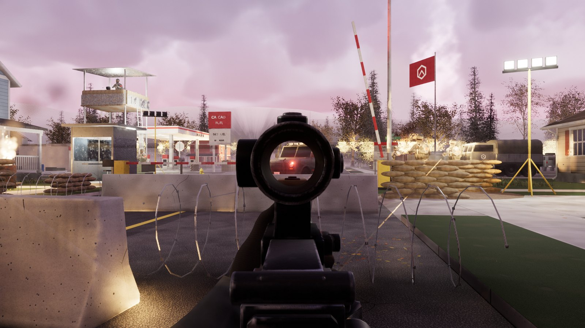
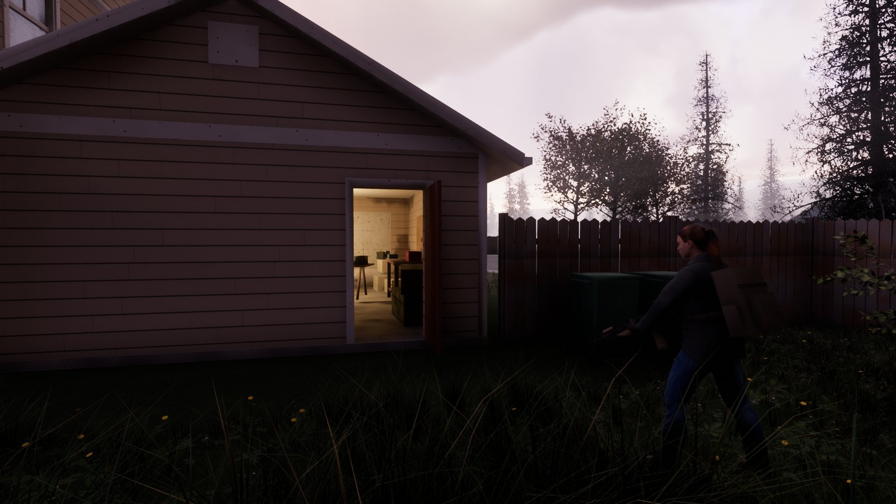
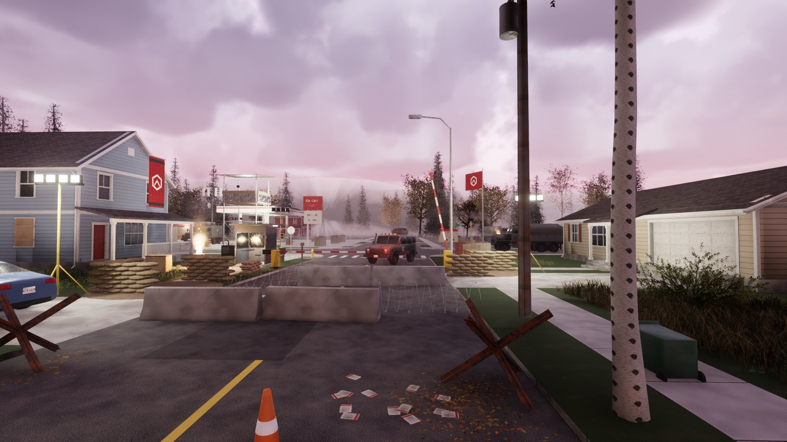
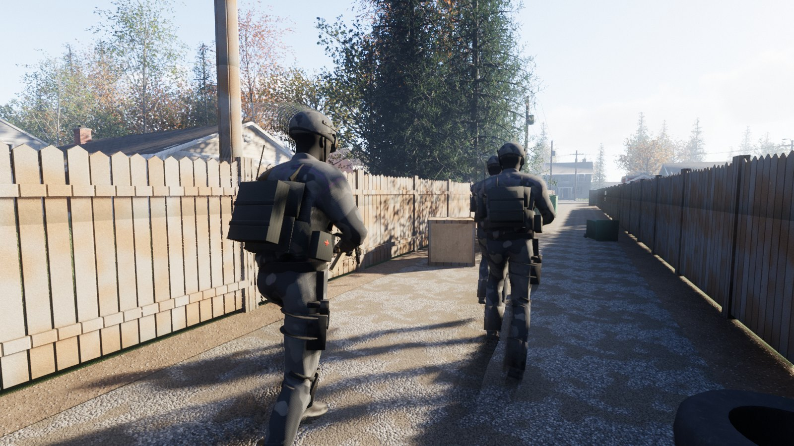
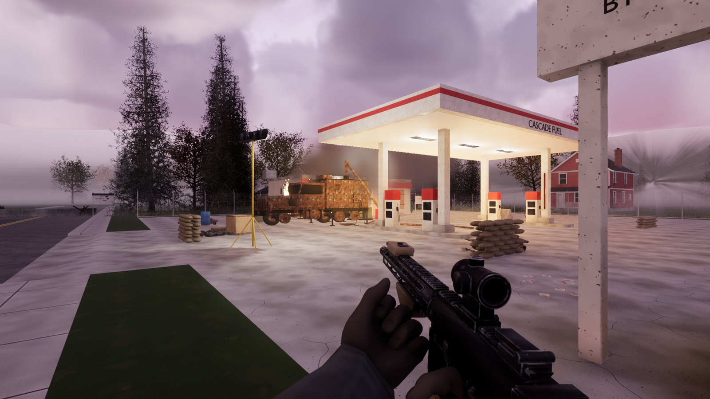
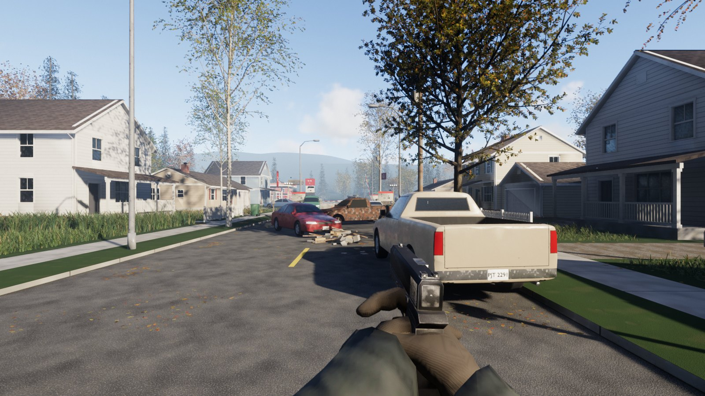
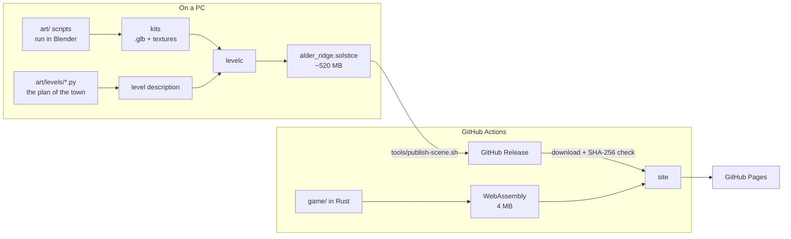

<div align="center">

# HOLDOUT

**A first-person shooter that runs in a browser tab.**<br>
Rust → WebAssembly + WebGPU, on the [Solstice](https://github.com/SamG-Coder/solstice) engine.

### [▶ Play it in your browser](https://samg-coder.github.io/holdout/)

[](https://github.com/SamG-Coder/holdout/actions/workflows/pages.yml)
[](https://github.com/SamG-Coder/holdout/releases/latest)


<a href="https://samg-coder.github.io/holdout/"></a>

</div>

## Mission one — Dead Air

*Alder Ridge, Oregon. Year two of the occupation.*

The Directorate has parked a jamming truck on the forecourt of the filling station, and the
town has heard nothing from outside since. Tonight the cell goes to break it. You leave the
safehouse garage with Mara and Dunn, cut through the back yards, fight down Alder Street to
the checkpoint, plant a charge on the truck, and hold the corner while it burns.

<table>
  <tr>
    <td></td>
    <td></td>
  </tr>
  <tr>
    <td></td>
    <td></td>
  </tr>
</table>

It is an original setting: the town, the factions, their marks and every word of it were
made for this game.

## Playing

Open **<https://samg-coder.github.io/holdout/>** in desktop Chrome or Edge. It needs WebGPU
and a real graphics card. The level is about 520 MB, but it is never downloaded whole: the
game streams what the view needs, so the title appears once the opening view has arrived.

| | |
|---|---|
| Move | `W` `A` `S` `D` |
| Look · fire · aim | mouse · left button · right button |
| Sprint · crouch · jump | `Shift` · `C` or `Ctrl` · `Space` |
| Reload | `R` |
| Carbine · pistol · swap | `1` · `2` · `Q` or the wheel |
| Grenade | `G` |
| Use (plant the charge) | hold `E` |
| Pause | `Esc` |

Add `?fps` to the address for a frame counter.

## What is in it

- **A whole town to fight through.** Nineteen houses on three streets, fenced yards and an
  alley, a fortified checkpoint with a watchtower, a filling station. Abandoned cars, autumn
  trees, two summers of unmown grass and a year of fallen leaves, under moving clouds at dusk.
- **Enemies that fight back.** Directorate soldiers see and hear, shout to each other, take
  cover and lean out of it, push forward when they lose sight of you, and reload behind sandbags. Paths come
  from a navigation grid sounded out of the level's own collision when it loads.
- **Friends who keep up.** Mara and Dunn wait for you at the garage door, follow through the
  yards and fight beside you.
- **Two weapons, held properly.** A carbine with a red-dot sight and a 9 mm pistol, with
  first-person arms placed by inverse kinematics, recoil, sway, aiming down the sights and
  reloads; grenades; ammunition scavenged from the rifles the dead drop.
- **A mission with a shape.** Ten stages with objectives, radio dialogue and checkpoints,
  ending in a charge that turns the jammer truck into a burning wreck with its mast down.
- **Sound with no sound files.** Every shot, footstep, impact, shout and note of music is
  synthesised in the browser with WebAudio.



## How it is made



**The game** (`game/`) is Rust compiled to WebAssembly. It draws with Solstice: virtualised
geometry in the manner of Nanite, voxel global illumination in the manner of Lumen, volumetric
clouds, GPU particles, and streaming by HTTP Range. On top of that it brings its own physics
(Rapier, with a kinematic character controller), navigation and AI, animation layer, weapons,
effects and mission script. The interface is HTML and CSS over the canvas.

**The art** (`art/`) is code. Nothing was modelled by hand and no texture was painted or
photographed:

- Tiling materials (asphalt, siding, shingles, rust…) are synthesised with numpy.
- Houses, props, vehicles and the ground are built by Python scripts in headless Blender. The
  ground is one surface cut to the plan in `art/levels/alder_layout.py`: roads, kerbs,
  drives and lawns.
- The weapons are modelled part by part, then textured by a small baker that reads the
  geometry (edges, cavities, occlusion) to place wear, grime and scratches.
- The people are [MakeHuman](http://www.makehumancommunity.org/) bodies made with MPFB,
  dressed in generated gear, and animated by retargeted clips with a procedural layer over
  them for aiming, holding a rifle and closing the hands.

**The level** is compiled by `levelc` from a description that `art/levels/alder_ridge.py`
writes. The result is one `.solstice` scene with the game's own manifest inside it: where
everything is, what it is made of, the mission's markers, the pools of hidden things the
game shows as it needs them.

## Hosting

The level needs Blender and a good many minutes to build, so CI does not build it:

1. `tools/publish-scene.sh` uploads the compiled level to a **GitHub Release** and writes the
   release's tag and the file's SHA-256 into [`scene.txt`](scene.txt).
2. Pushing to `main` runs [the Pages workflow](.github/workflows/pages.yml). It fetches the
   engine at the commit [`engine.txt`](engine.txt) names, compiles the game to WebAssembly,
   downloads the scene `scene.txt` names, checks its hash, and deploys both to
   **GitHub Pages**.

The scene is served from the same site as the game, because the game reads it by HTTP Range
and release downloads cannot be fetched across origins.

## Building it yourself

You need Rust (the version in `rust-toolchain.toml`, with the `wasm32-unknown-unknown`
target), Python 3, and for the art Blender 5.x with the MPFB extension and its system assets.

```bash
# The engine, at the commit this game is built against
bash tools/setup-engine.sh

# The browser game with the published level, then a server to try it
gh release download --pattern '*.solstice' --dir build/levels
bash tools/build-web.sh
python engine/scripts/serve.py --directory dist --port 8765     # http://localhost:8765
```

<details>
<summary><b>Rebuilding the art and the level</b></summary>

```bash
B="blender --background --factory-startup --python-exit-code 1 --python"

# Textures, then each kit of models (minutes each; only when its script changes)
$B art/make_materials.py
$B art/weapons/carbine.py
$B art/weapons/pistol.py
$B art/fx_kit.py
$B art/world/houses.py
$B art/world/props.py
$B art/world/vehicles.py
$B art/world/ground.py
$B art/world/litter.py
python art/build_characters.py            # soldier, rebel_a, rebel_b, arms

# The level: a script writes its description, levelc compiles it
cargo build --release -p levelc -p holdout
python art/levels/alder_ridge.py
./target/release/levelc build/levels/alder_ridge.txt --output build/levels/alder_ridge.solstice

# Publish it
bash tools/publish-scene.sh
git add scene.txt && git commit -m "Publish scene" && git push
```

The animation clips are from Quaternius' Universal Animation Library, which is not kept in
git: unpack it with the engine's `scripts/fetch-ual.py` and put `UAL1_Standard.glb` and
`UAL2_Standard.glb` under `build/ual/ual1/` and `build/ual/ual2/`. `art/build_characters.py`
looks for Blender at `D:/Blender/blender.exe` unless `BLENDER` says otherwise.

</details>

<details>
<summary><b>Trying things without playing</b></summary>

There is a desktop build of the same game, which runs a script of commands at given frames
and saves pictures. Every picture on this page was taken this way.

```bash
./target/release/holdout-desktop build/levels/alder_ridge.solstice \
  --capture out.png --frames 600 --size 1600x900 \
  --do "1: god; 100: goto 88 0 1.5 -1.57; 400: shot checkpoint.png"
```

Commands: `goto x y z yaw`, `fly x y z yaw pitch`, `walk`, `look yaw pitch`, `fire FRAMES`,
`key CODE down|up`, `button left|right down|up`, `mouse dx dy`, `time HOURS`, `weather NAME`,
`exposure X`, `hip x y z pitch yaw roll`, `god`, `mortal`, `retry`, `kill GROUP`, `used NAME`,
`explode x y z`, `shot FILE`. Its last lines report frame times, where the game's own time
went, and the mission's stage. In the browser the same commands go through
`holdout.debug("…")` in the console.

</details>

## Where things are

| | |
|---|---|
| `game/` | The game: player, weapons, people and their AI, navigation, effects, missions, and the web and desktop front ends |
| `levelc/` | Compiles a level description into a Solstice scene with the game's manifest inside |
| `web/` | The page: title, HUD, settings, streaming, synthesised sound |
| `art/lib/` | Texture synthesis, mesh building, the baker for weapons and gear, cutting regions into surfaces |
| `art/world/` `art/weapons/` `art/characters/` | What builds each kit of models |
| `art/levels/` | The plan of the town, and the script that places everything and writes the mission's markers |
| `tools/` | Fetching the engine, building the site, publishing a scene |
| `patches/` | The game's additions to the engine's renderer: camera roll, and lights the game can move |

## Where it stands

One mission, playable from the garage to the end screen. It has been checked by scripted
runs and pictures in both the desktop and the browser builds: every stage of the mission,
dying and retrying from a checkpoint, the routes through the yards, and frame times (4 to
5 ms a frame on the desktop build at 1080p, and 85 to 105 frames a second in Chrome, on the
high-end desktop it was made on).

It has not yet been played through by hand from end to end, so its difficulty and pacing are
tuned by measurement, and its sound has been written but not listened to critically.
Houses other than the safehouse garage and the station shop are closed shells.

## Credits

- **[Solstice](https://github.com/SamG-Coder/solstice)**, the engine (MIT).
- **[Rapier](https://rapier.rs)** for physics, **[wgpu](https://wgpu.rs)** and
  **[glam](https://github.com/bitshifter/glam-rs)** underneath (Apache-2.0 / MIT).
- **[Universal Animation Library](https://quaternius.com)** by Quaternius, for the animation
  clips (CC0).
- **[MakeHuman](http://www.makehumancommunity.org/)** and the **MPFB** extension for
  Blender, for the bodies, skins, clothes and hair of the people (CC0 assets).
- **[Blender](https://www.blender.org)**, which runs every art script.

No licence has been chosen for this repository yet.
